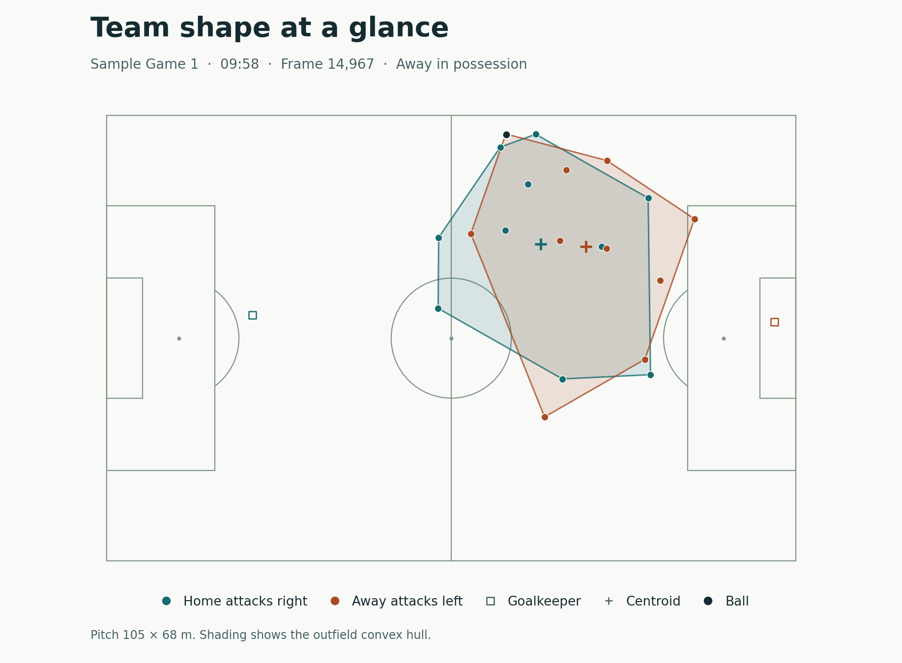

# Football team shape and physical load

Do teams change their shape and running output when they have the ball, and can shape predict possession in an unseen match? Using 25 Hz tracking from two Metrica Sports sample matches, I found that teams were **10.5–13.7 m wider in possession** across all four team-match comparisons. Total and high-speed distance per player-minute were higher out of possession in three of four comparisons, while sprint distance was higher in possession in two and out of possession in two. A random forest trained on Game 1 reached **83.2% accuracy on Game 2**, compared with **50.0%** for the majority-class baseline.

## Results

| Model | Game 1 blocked CV accuracy | Game 2 held-out accuracy | Game 2 ROC AUC |
| --- | ---: | ---: | ---: |
| Majority-class baseline | 50.0% | 50.0% | 0.500 |
| Logistic regression | 78.2% | 82.5% | 0.880 |
| Random forest | 82.5% | **83.2%** | **0.914** |

Game 1 cross-validation scores are means across four chronological folds. The held-out test used 2,725 labelled instants, with one row for each side at every instant. Each pair contains one in-possession row and one out-of-possession row, giving the constant baseline 50.0% accuracy.

The average outfield centroid was 10.5–15.0 m farther upfield in possession. The high-speed running pattern varied by side. For example, Game 1 Home covered 19.25 m per player-minute in possession and 8.48 out of possession, while Game 1 Away covered 7.29 in possession and 21.29 out of possession. [Shape by phase](results/shape_by_phase.csv) · [Load by phase](results/load_by_phase.csv)

[Five-minute load figure](results/figures/02_load_by_block.png) · [Cross-match results figure](results/figures/03_cross_game_results.png) · [Fold-level scores](results/model_scores.csv)

## Method

1. **Tracking and shape.** I matched Home and Away tracking by period, frame and time, then converted the 0–1 coordinates to a centred 105 × 68 m pitch. For each half, I inferred the goalkeeper and attack direction from the first 10 seconds of tracking. After orienting each team to attack toward positive x, I computed the outfield centroid (x and y), length, width, convex hull area and defensive line height. Line height is the median longitudinal position of the four deepest outfielders, measured from their own goal line. Each usable frame has ten valid outfield positions.
2. **Physical load.** A centred, 15-frame Savitzky–Golay derivative estimated player speed. I excluded estimates above 12 m/s and filter windows containing a raw step above that threshold. I computed total distance, high-speed distance (>5.5 m/s), sprint distance (>7 m/s) and sprint bouts per player per five-minute block. A bout requires at least one continuous second above 7 m/s. For phase comparisons I divided outfield distance by observed player-minutes.
3. **Possession.** I used pass and shot intervals and event anchors such as recoveries and restarts. I bridged gaps of up to 10 seconds between consecutive same-team anchors where the earlier event supported continuity and no recorded stoppage or uncertain recovery intervened. I left conflicting and unsupported intervals unlabelled. [Frame coverage and tracking checks](results/data_quality.csv)
4. **Validation.** I avoided random frame splits because neighbouring 25 Hz frames are near-duplicates. I sampled one frame per second for modelling, kept both teams from each instant together and used four expanding-window validation folds in Game 1 with a 60-second gap before each validation window. Then I trained on eligible Game 1 rows and scored on Game 2. The six predictors describe team shape and pitch position. Events, the ball, team IDs and time were excluded from model inputs.

## Run in Google Colab

1. Download [`team_shape_tracking_colab.ipynb`](team_shape_tracking_colab.ipynb).
2. Open Colab and choose **File → Upload notebook**. Select the downloaded notebook. [Google Colab](https://colab.research.google.com/)
3. Use a **CPU** runtime and choose **Runtime → Run all**. The default data source downloads the six CSVs for Sample Games 1 and 2 from the pinned Metrica repository.
4. The final cell creates `team_shape_tracking_results.zip` with the figures, tables and full 25 Hz team-shape export. Download it from the Colab Files panel or set `DOWNLOAD_RESULTS` to `True` in the final cell.

For a local copy of the source data, choose `ZIP` in the notebook’s first section and upload an archive containing the Home tracking, Away tracking and events CSVs for both matches. That section lists the exact filenames.

## Limitations

- **Two anonymised matches.** The analysis tests transfer to one held-out match. Team overlap is unknown, and nearby test frames remain correlated. My wearable-data literature review motivated the cross-match test.
- **Event-derived labels.** The rules labelled 44.6% of Game 1 and 48.2% of Game 2. Clear on-ball sequences are more likely to be included than loose balls and ambiguous transitions. The scores and phase comparisons describe the labelled subset.
- **2D ball tracking.** My dissertation motivated my interest in ball movement. The dataset includes horizontal ball coordinates. Extending the work to ball-flight trajectories or Magnus-effect modelling would require 3D tracking with height.

## Repository files

| File or folder | Contents |
| --- | --- |
| [`team_shape_tracking_colab.ipynb`](team_shape_tracking_colab.ipynb) | Data loading, feature extraction, validation and figure generation |
| [`results/figures/`](results/figures/) | Pitch snapshot, load by block and held-out model scores |
| [`results/`](results/) | Model scores, phase summaries, five-minute player loads and data quality checks |

## Data source and licence

Tracking and event data come from **Metrica Sports Sample Data**, Sample Games 1 and 2, at revision `e706dd506b360d69d9d123d5b8026e7294b13996`. The upstream repository has no standalone or named licence at that revision. Its README asks for responsible use and attribution in public work. The notebook retrieves the original CSVs directly from Metrica. [Metrica repository and usage terms](https://github.com/metrica-sports/sample-data/blob/e706dd506b360d69d9d123d5b8026e7294b13996/README.md#legal-stuff) · [Event definitions](https://github.com/metrica-sports/sample-data/blob/e706dd506b360d69d9d123d5b8026e7294b13996/documentation/events-definitions.pdf)
